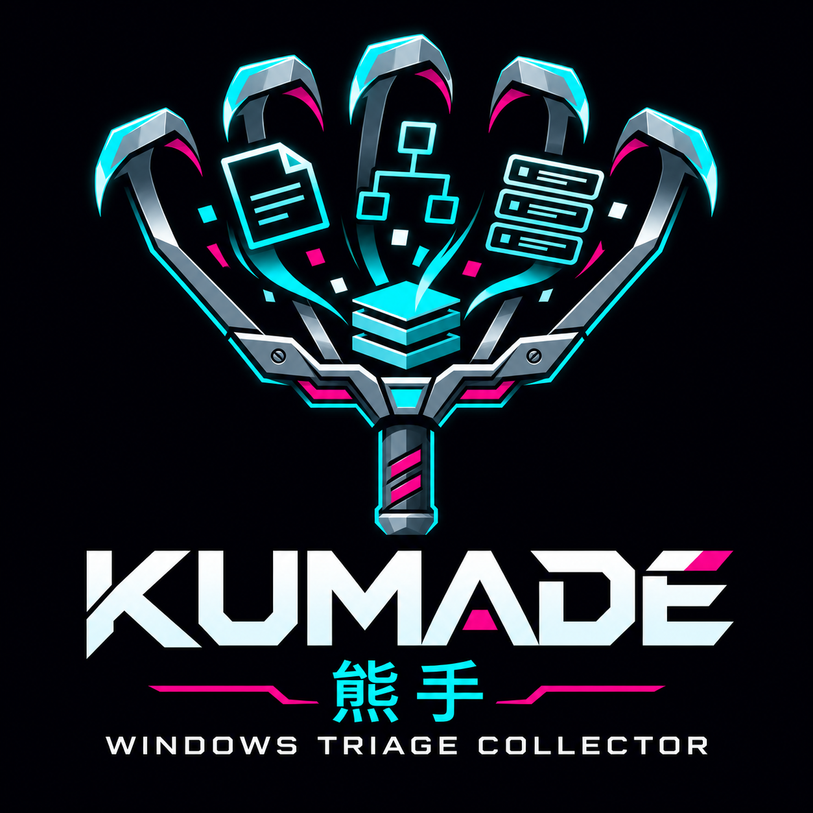

<p align="center">
  
</p>

# Kumade（熊手）

**Windows evidence collection by Yamato Security.**

Kumade is an independent Rust collector under **RPL-1.5**. It acquires evidence
for tools such as Juntei and Hayabusa. This repository contains the first
development implementation.

Download **[Kumade v0.1.0 for Windows x86 (32-bit), x64 or ARM64](https://github.com/Yamato-Security/kumade/releases/tag/v0.1.0)**.
See the release notes for the development limitations and platform validation status.
Each Windows build is available as a standalone `.exe` and a ZIP containing
only that `.exe`. Documentation is on this site; license notices accompany the
downloads as `LICENSES.txt`. Rename the executable to `kumade.exe` to use the
Windows examples below.

## Implemented

- Interactive [collection wizard](docs/collection-wizard.md) with estimated logical transfer sizes, artifact selection and conservative defaults. `--yes` accepts defaults without prompts for automation; `--paging` opts into large paging/hibernation/existing dump files.

- Optional [high-entropy binary collection](docs/high-entropy.md): `--high-entropy` scans selected source drives for PE executable-section packing candidates, copies them through normal acquisition, and records sealed CSV/JSONL analysis with source hashes.

- Optional [VSS acquisition](docs/vss.md) with `--vss`: owned crash-consistent snapshots for locked-file collection and partition imaging, snapshot provenance and automatic cleanup. `--volume C:` selects live collection volumes.

- [Raw partition imaging](docs/forensic-copy.md): `forensic-copy` reads a logical Windows partition into a `.dd` file on a different external disk, with physical-disk separation checks, SHA-256 readback verification and a JSON receipt.

- [Live-response inventory](docs/live-info.md): 59 structured Windows data sets in CSV, JSON or JSONL, with UTC observation times, PascalCase fields and sealed provenance. Included automatically in live collections; inventory-only `live-info` is also available.

- Embedded acquisition catalog with 43 artifact families, including event logs,
  registry, Prefetch, Jump Lists, SRUM recovery families, browsers, Outlook,
  local GPO/SYSVOL, Defender and standard paging-file locations.
- Offline collection from Windows volume directories on Linux, macOS and Windows.
- Windows fixed-volume/mount-point discovery, profile discovery and backup privilege
  setup. Windows x86/x64 CI includes NTFS VHDX round trips; targeted live
  collection and metadata tests also run on Windows 11 ARM64.
- Read-only raw NTFS fallback for discovered locked files and hidden metadata,
  including resident/nonresident data, named streams and sparse logical content.
- Parallel acquisition, bounded copy/hash buffers, sparse output where supported,
  SHA-256 verification, original access/modified times and separate provenance.
- JSONL/CSV manifests, family coverage, explicit failures, metadata seals and a
  verifier that rejects modified payloads and unsafe manifest paths.
- Protected fresh run directories, no overwrite of existing payloads, source/output
  separation for offline evidence, and terminal progress.
- Optional [NTFS VHDX output](docs/vhdx-output.md) with direct acquisition into
  a dynamic image, native alternate streams and explicit NTFS metadata preservation.
- Optional [compressed E01 output](docs/e01-output.md), with the same NTFS
  preservation, split EWF1 segments, automatic hash verification and a receipt.
- Green Kumade terminal banner and labels, white values, and a green progress
  bar with elapsed time, file counters, percentage, filename and approximate size.
  Redirected output is plain text; `NO_COLOR` disables terminal colors.
- Acquisition defaults to up to four workers (limited by available logical CPUs);
  `-T, --threads` overrides it within that limit. `-v, --verbose` lists each file/stream being copied instead of
  displaying a progress bar. Running without arguments displays help.

## Run locally

Building from source requires Rust 1.99 or later.

```bash
cargo build --release
./target/release/kumade doctor
./target/release/kumade list

# SOURCE is a Windows volume root containing Windows/Users/ProgramData.
./target/release/kumade plan -d /cases/host/C -o /cases/plans/host --computer HOST01
./target/release/kumade -d /cases/host/C -o /cases/collected --computer HOST01
./target/release/kumade verify /cases/collected/HOST01_<UTC>_<RUNID>
```

On Windows, run an elevated PowerShell session for live collection:

```powershell
.\kumade.exe -o E:\Kumade-Results

# Use crash-consistent snapshots of selected live volumes for locked files:
.\kumade.exe collect --vss --volume C: -o E:\Evidence

# Or save the entire acquisition in one new NTFS VHDX:
.\kumade.exe --vhdx E:\Evidence

# Or package the NTFS collection into compressed E01 segments:
.\kumade.exe --e01 E:\Evidence

# List each copied file instead of displaying progress:
.\kumade.exe --vhdx E:\Evidence -v
```

Without `--source`, only Windows live mode is accepted. Offline mode never
automatically reads the analyst's own Windows directories. Repeat `--source`
for disjoint volume directories; use `--profile-root` for nonstandard profiles.
`--artifact <ID>` explicitly narrows acquisition and records excluded families.
The default reserves 2 GiB of destination space; `--reserve-mib` changes it.

For a bit-for-bit logical partition image instead of selected artifact collection,
run from an elevated PowerShell session, with `E:` on a different external disk:

```powershell
.\kumade.exe forensic-copy -s C: -o E:\Evidence
```

This creates `<Hostname>_<UTC>/C.dd` and `ForensicCopy.json`. It does not overwrite
the external disk's partition table or existing files. See [forensic-copy](docs/forensic-copy.md)
for storage restrictions and the consistency limits of live-volume reads.

Each run creates `Plan.json`, `Run.json`, `Manifest.jsonl`, `Manifest.csv`,
`Coverage.csv`, `DiscoveryIssues.csv`, `Errors.csv`, `Summary.json` and `Seal.json`.
Each run directory is named `<Hostname>_YYYY-MM-DD_HH-MM-SS`, using the UTC
start time; there is no random suffix. A repeated host/start time refuses to
overwrite an existing collection. Payloads preserve their original paths directly
beneath their drive letter, with no acquisition-method wrapper directories:

```text
HOST01_2026-11-20_15-23-12/
  C/Windows/System32/config/SYSTEM
  C/Windows/System32/drivers/etc/hosts
  C/$MFT
  C/$Extend/$UsnJrnl/$J
  D/$MFT
  E/$MFT
  LiveInfo/...
  client_info.json
  Manifest.csv
  ...
```

For live collection, every local fixed volume receives the same catalog
scope: each selected artifact family is checked on every volume, so
profiles that `ProfileList` places on a data volume, `$Recycle.Bin`, IIS and
SQL Server logs are acquired wherever they are. NTFS volumes additionally
receive their NTFS metadata files: `$MFT`, `$LogFile`, USN `$J`/`$Max`,
`$Secure:$SDS`, `$Boot` and `$Bitmap`. Unlettered volumes use a stable
`Volume-<id>` folder.

The volume that holds the destination is excluded, except for the running
Windows volume, which is always acquired and noted as a live destination.
Destination matching uses the volume identity, including GUID paths and mount
aliases. Volumes without a readable filesystem (unformatted or BitLocker-locked)
are recorded as excluded rather than failing the run. Removable media is not
acquired by default.
`--artifact` can narrow the scope; explicit offline `--source` inputs keep the
full selected scope.

`--vhdx E:\Evidence` and `--e01 E:\Evidence` create hostname/date-named
containers in that directory. With no value, they use the `Kumade-Results`
directory beside the executable, the same default as `-o`; the shell's current
directory is never used. A full filename remains an explicit override. Both containers contain the same
hostname/date run directory and drive-based layout. A sealed `client_info.json`
host marker lets Juntei group all of the run’s drive folders as one computer.
Windows-incompatible names are reversibly encoded; exact source paths remain
in the manifest. Very long names in directory mode use a manifest-mapped hash path.
For the VHDX layout, metadata fields and fidelity limits, see
[NTFS VHDX output](docs/vhdx-output.md).

`Verified` means stored-byte hash verification, **not structural validity or an
atomic snapshot**. Source changes produce a partial result. A seal currently
uses hashes, not an authenticated signing identity.

## Not implemented yet

RAM capture/paired runtime pagefile discovery, application-writer-coordinated VSS backups, external processing,
image-source CLI support, ZIP archive packaging, cloud upload, resume,
general directory-mode ADS discovery and structural artifact validators are pending.
VHDX mode inventories named data streams on selected files.

`--memory` currently records an explicit failed RAM task and returns partial
status after collecting supported disk artifacts. It never creates a fake dump
or silently reports memory acquisition as successful. Standard paging-file paths
are included in the disk catalog; custom active pagefile enumeration is pending.

Raw compressed/encrypted/reparse-backed content is rejected rather than copied
as incorrect logical bytes. Directory enumeration failures remain visible;
raw traversal of inaccessible directories is not implemented yet. Planning keeps
the task index in memory; million-file/disk-backed scheduling remains future work.
Use controlled lab data while broader Windows, destination-policy and coverage
qualification continues.

## Development

```bash
cargo fmt --check
cargo test --all-targets
cargo clippy --all-targets -- -D warnings
cargo check --target x86_64-pc-windows-gnu
```

Tests include an attributed, redistributable synthetic NTFS image and generated
fixtures. Private evidence and validation output are kept outside this repository.
The `ntfs` dependency currently brings `binrw 0.11.3`, for which Rust reports a
future-compatibility warning; it does not fail the current build.

See [validation results](docs/testing.md), [implementation status](docs/implementation-status.md),
[architecture](docs/architecture.md) and [reference-tool comparison](docs/tool-comparison.md).

Copyright © 2026 Shirofune Security Co., Ltd. Original Kumade code and definitions
are licensed under [RPL-1.5](LICENSE). Third-party fixtures/dependencies keep their
own licenses; see [fixture provenance](tests/fixtures/SOURCES.md).

## Process-memory YARA hunting

Use `kumade scan-processes -o Yara-Results` for an opt-in live memory scan with YARA Forge Core (default), Extended, Full or local rules. See [process-memory scanning](docs/yara-process-scan.md) for options, coverage/error reporting and interpretation limits.
