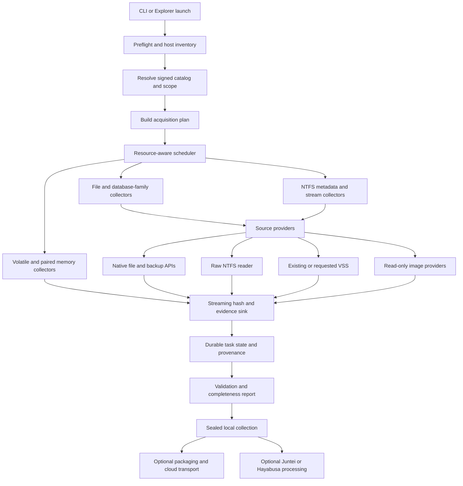

# Kumade — Windows evidence collection by Yamato Security

**System design and implementation architecture · Proposal v0.1 · 18 November 2026**

**Language:** Rust, edition 2024. **License:** Reciprocal Public License 1.5 (`RPL-1.5`), matching current Juntei. **Initial platform:** Windows. **Initial destination:** local disk or an explicitly selected network share. **Future destinations:** S3-compatible storage, Azure Blob Storage and other approved cloud backends.

This document describes the target design. The initial implementation is available; [implementation status](implementation-status.md) distinguishes its current features from planned capabilities. Parity with the reference tools has not been demonstrated. The accompanying [tool comparison](tool-comparison.md) documents the researched projects, their strengths, limitations, licensing and reviewed revisions.

## 1. Product definition

**Kumade collects the evidence. Hayabusa, Takajo and Juntei analyze it.**

Kumade should be the collector an analyst can run without knowing dozens of artifact names, selecting a collection definition or remembering that a database needs its transaction logs. The default collects every supported acquisition family across the scoped machine, records what could not be obtained, and produces evidence that existing analysis tools can consume.

Kumade aims for **broad verified defaults, reliable discovery, explicit completeness and a simple operator experience**. Coverage and acquisition quality must be demonstrated with repeatable tests.

### Required outcomes

1. One normal command collects all supported local Windows triage evidence, without requiring a target name.
2. Files locked by services or applications have supported alternative acquisition paths.
3. `--memory` captures a coordinated **RAM plus all discovered active pagefiles** bundle, alongside the ordinary collection.
4. Original bytes, provenance, source timestamps, streams, failures and collection-induced changes remain explainable.
5. Collection, hashing and packaging stream through bounded buffers; large evidence does not imply equally large RAM or duplicate temporary-disk usage.
6. Work is parallelized according to actual storage devices and resource limits.
7. Definition import and processing interoperability require tested semantics; unsupported settings must be reported explicitly.
8. A new output adapter can add cloud transport without replacing the acquisition engine.

### What “collect everything possible” means

It means **all enabled, supported acquisition definitions within the explicit source scope**, including all local profiles, supported application stores, database companions and applicable host roles. It is not a promise to discover every future application, defeat encryption, recreate deleted data already overwritten, or capture a perfectly atomic live computer.

The default is not a full forensic disk image or a recursive copy of every file on every disk. Whole-volume imaging can become a separate optional capability. Files that have never been logged, data already overwritten, unavailable remote/cloud content and unsupported protected memory remain explicit limitations.

## 2. Default collection policy

| Area | Proposed default |
|---|---|
| Scope | All accessible local fixed volumes, volume mount points and local profile roots; removable, remote and image sources can be explicitly included |
| Artifact selection | Every shipped applicable acquisition family; users may explicitly narrow scope |
| Dates and sizes | No silent date filter, maximum file size, first-N rows or first-N profiles |
| Volumes | Identify by volume GUID/serial/partition information, preserving all observed drive-letter and mount-point aliases |
| Profiles | Combine ProfileList, loaded profile information, filesystem discovery, service profiles, Public and default profiles; preserve source SID associations |
| Paging/hibernation | Collect discovered pagefiles, swapfile and hibernation artifacts when present; include their large sizes in preflight |
| RAM | Opt-in because it needs a qualified memory provider and has different operational impact |
| Existing VSS | Discover and collect applicable evidence from all accessible existing snapshots; retain each origin even when bytes match |
| New VSS | Opt-in with `--vss create`; default collection must not create snapshots or evict existing ones |
| Unavailable privileges | Report a clear requirement; an explicit `--limited` mode may run a reduced, visibly incomplete collection |
| Processing | Acquisition validation only by default; optional processing is separately requested |
| Destination | New run directory; no implicit deletion or reuse of an earlier result directory |
| Internet | No runtime dependency download, update check or upload during ordinary offline collection |

Existing snapshots are **additional historical evidence**, not replacements for unreadable current files. If the live version cannot be acquired, an older snapshot cannot make that live task successful.

Large artifacts such as OST/PST, pagefiles, hibernation files, server databases and historical snapshots can make this default expensive. Show estimated logical bytes, expected destination allocation and unknown-size items before acquisition. If the destination cannot hold the requested scope, require another destination or an explicit narrower plan; never silently skip the large files. A `--profile quick` option may deliberately reduce scope, with every exclusion recorded.

Do not follow arbitrary UNC profile paths, remote reparse targets or cloud placeholders into network retrieval merely because they were discovered. Inventory them and explain why their content is outside the current scope. Hydration or remote collection needs an explicit option and a separate provenance record.

## 3. User experience and CLI

### Common examples — proposed syntax

```powershell
# Broad default collection; output is a new run beneath this directory.
kumade.exe -o E:\Kumade-Results

# Same collection, with a paired RAM/pagefile capture.
kumade.exe -o E:\Kumade-Results --memory

# Inspect scope, estimates, privileges and unsupported items before collecting.
kumade.exe plan -o E:\Kumade-Results --memory

# Explicitly choose a smaller scope.
kumade.exe collect -o E:\Kumade-Results --profile quick

# Verify a completed or interrupted collection without changing its evidence.
kumade.exe verify E:\Kumade-Results\HOST01_20261118T040000Z_RUNID

# Resume work; live unsealed files are reacquired, not byte-appended.
kumade.exe resume E:\Kumade-Results\HOST01_20261118T040000Z_RUNID
```

Running `kumade.exe` without a subcommand aliases `collect`. With no `-o`, use a new `Kumade-Results` directory beside the executable if writable. If not writable, fail with a useful `-o` example instead of choosing an undocumented temporary location. Warn prominently when the chosen destination is on an acquired source volume.

An Explorer launch should provide the Yamato-style logo, plain introduction, destination/scope summary and OS elevation prompt where needed. A normal elevated CLI run should not require a second generic confirmation. Noninteractive operation must not hang waiting for elevation or input.

Proposed commands are listed alphabetically in help: `collect`, `compat`, `doctor`, `list`, `pack`, `plan`, `process`, `resume`, `upload`, `verify`. Expose commands only when their implementation is available; cloud commands remain future work. Keep flags consistent: `-o, --output`, `-T, --threads`, `-m, --memory`, `--profile`, `--source`, `--volume`, `--exclude`, `--vss`, `--limited`, `--debug`.

### Progress and summary

Use separate phases: preflight → volatile evidence/memory bundle → discovery → acquisition → validation → packaging/seal. Show file count, acquired bytes, current artifact/path and approximate source size, throughput, elapsed time and meaningful ETA. Discovery can be indeterminate; do not invent a percentage before work is known.

Progress rendering must truncate long paths to terminal display width, including Japanese characters, without wrapping the bar. Child-process messages go through one renderer; redirected output becomes plain log lines. Use IEC sizes consistently and preserve logs independently of the terminal.

```text
KUMADE — Windows Evidence Collection
Computer: HOST01
Scope: Full / 3 volumes / 14 profiles / 4 existing snapshots
Memory: Requested — RAM + 2 active pagefiles
Timezone: UTC

Acquiring: SRUM database family (84.2 MiB)
[========================>             ] 67%  11.8 GiB / 17.6 GiB

Results Summary:
Collected:                  12,438
Not present / inapplicable:    176
Explicitly excluded:            0
Incomplete families:            1
Failed:                         2
Results saved: E:\Kumade-Results\HOST01_...\ ( 12,514 files / 18.2 GiB )
Completeness: PARTIAL
  HOST01 / SRUM: Recovery log unreadable (details: Errors.csv)
```

These values are illustrative. Do not present the sample as a benchmark.

## 4. High-level architecture



Acquisition, processing and transport have independent lifecycles. A failed parser does not erase a successfully acquired original. A failed upload does not make a local collection disappear. A successful upload does not prove acquisition was complete.

### Initial workspace structure

```text
kumade/
  crates/
    kumade/                 CLI, progress, orchestration, optional processing
    kumade-core/            Plans, identities, manifests, sink interfaces, validation
    kumade-windows/         Windows APIs, volume access, VSS, memory providers
    kumade-compat/          Definition import and compatibility reporting
  artifacts/              Reviewed acquisition definitions and test expectations
  profiles/               full, quick, and explicit organization profiles
  schemas/                Versioned definition/manifest/plan schemas
  tests/
    fixtures/             Synthetic and redistributable public fixtures
    integration/          Elevated Windows VM acquisition tests
    interoperability/    Collector/Juntei/Hayabusa comparisons
  docs/
```

Implement acquisition strategies, storage and memory adapters as modules inside these crates initially. Split out a reusable `ys-*` crate only when there is a stable, independently useful API. Do not create a separate repository for every artifact path rule.

## 5. Acquisition lifecycle and durable task model

1. **Preflight:** establish run ID, operator context, elevation, available privileges, destination filesystem/free space, OS/architecture, tool/catalog versions and memory-provider availability.
2. **Minimal volatile discovery:** record the information necessary to start RAM/pagefile capture promptly. Avoid a full disk crawl before memory acquisition.
3. **Volatile capture:** collect timestamped native process/network/session state; if requested, prioritize the paired memory workflow. Record the order and overhead.
4. **Discovery:** enumerate volume identities, local profiles, registered event channels, application stores, host roles and existing snapshots. Enumerate disk-backed artifacts even when directory APIs do not expose them.
5. **Planning:** expand typed definitions, group database dependencies, resolve overlaps, estimate costs and record exclusions/unsupported capabilities.
6. **Acquisition:** execute bounded tasks, preserving separate source observations and every acquisition attempt.
7. **Validation:** assess bytes, hashes, structural readability and family completeness without repairing the originals.
8. **Seal:** finalize metadata, manifests and completeness results; hash/sign the final seal where configured.
9. **Optional processing/transport:** consume sealed evidence; preserve separate outcomes and logs.

Task states are `Planned`, `Running`, `Acquired`, `Validated`, `Failed`, `Partial`, `NotPresent`, `NotApplicable`, `Excluded` and `Unsupported`. `Acquired` does not mean structurally readable; `Validated` does not mean an artifact proves a particular attack. Content may be a faithful copy of an already-damaged source.

Every started task must have a terminal result after recovery. An enumeration error must not become “0 matches.” A successful child-process exit must not become “memory complete” without inspecting its output.

### Exit codes

| Code | Meaning |
|---|---|
| `0` | Completed requested scope; required acquisition and configured verification passed |
| `2` | Invalid arguments, configuration or unsupported plan before collection |
| `3` | Partial collection: any required acquisition, memory or validation failure |
| `4` | Destination/storage failure, including exhausted space |
| `5` | Verification/integrity failure when checking an existing collection |
| `130` | Operator cancellation; preserve interrupted state and already acquired evidence |

Absent optional artifacts and inapplicable host roles do not automatically fail a run. An explicitly requested RAM capture is required. A deliberately excluded artifact is recorded as excluded, not as successfully acquired or mysteriously absent.

## 6. Source identity and discovery

### Volumes and filesystems

Use Windows volume/mount-point APIs rather than looping only over `A:` through `Z:`. Record GUID paths, serial numbers, mount points, disk/partition relationships, filesystem type, encryption/unlock state, logical/physical sector sizes and source-device identifiers. Folder-mounted volumes and multiple aliases must not cause omissions or duplicate traversal.

Native acquisition can operate on supported readable filesystems. Raw NTFS is a specific capability: do not interpret ReFS, FAT/exFAT, encrypted physical sectors or an unknown filesystem as NTFS. Preserve supported evidence through native/VSS paths and mark unsupported metadata operations explicitly.

On an unlocked BitLocker volume, qualify the exact logical-volume read path used by the backend. A physical-disk ciphertext read is not equivalent to a decrypted logical file. Locked volumes require supplied access/unlock outside normal collection; Kumade does not defeat encryption.

### Profiles and host roles

Profile discovery must include nonstandard locations, unloaded profiles, service accounts, service profiles and orphaned on-disk profiles. Use SID/path mappings rather than assuming every profile is `C:\Users\<name>`. Never mistake the collector's `%USERPROFILE%`/HKCU for all users.

Discover relevant local roles and stores: domain controllers, IIS, SQL Server, RDS, installed browsers and their profiles, Outlook, application caches and virtualization/container artifacts. Role detection enables extra acquisition; it must not require remotely querying the domain or running a product's executables.

### Reparse points, names and hostile paths

Use explicit, bounded traversal. Track volume/file identity to prevent loops; follow known in-scope mount points, not arbitrary symbolic links into remote or excluded storage. Exclude the destination by identity as well as normalized path so output cannot collect itself.

Retain original UTF-16 names, including names not safely representable as normal Unicode strings. Keep a display form plus a lossless encoding where needed. Avoid `to_string_lossy` as evidence identity. Encode destination collisions, reserved names, ADS separators, case-sensitive directory differences and overlong paths reversibly; record every mapping. Never permit an evidence path or catalog entry to escape the destination root.

## 7. Locked-file acquisition strategy

There is no single Windows flag that makes every locked file safely readable. Use an explicit capability-based ladder for each **specific source observation**:

1. Open the file with the necessary native read access and compatible sharing flags.
2. Use approved backup semantics and `SeBackupPrivilege` where appropriate.
3. Read the same file/stream through the raw NTFS provider when native access is blocked and the representation is supported.
4. If a separately identified snapshot exists, acquire its version as a different observation—not a silent fallback replacement for the live version.
5. Where available, create an explicitly labeled derived API export in addition to or instead of a failed original-copy task. The original task remains failed if original bytes were not obtained.

`SeBackupPrivilege` helps with access-control restrictions; do not assume it defeats conflicting sharing modes. `BackupRead` needs a synchronous handle and has its own API constraints; it must not share an overlapped/raw-read implementation accidentally. [Windows privileges](https://learn.microsoft.com/en-us/windows-hardware/drivers/ifs/privileges), [CreateFileW](https://learn.microsoft.com/en-us/windows/win32/api/fileapi/nf-fileapi-createfilew), [BackupRead](https://learn.microsoft.com/en-us/windows/win32/api/winbase/nf-winbase-backupread).

### Raw NTFS requirements

- Resident and nonresident attributes; fragmented runlists and attribute-list extensions.
- Correct initialized/logical/allocated size handling, sparse regions and sector alignment.
- Named `$DATA` streams and required NTFS metadata streams.
- Original file references, sequence numbers, hardlinks and timestamps.
- Read bounds, malformed structures, arithmetic overflow, loops and partial extents.
- An explicit capability result for compressed, encrypted, WOF-backed and reparse-backed content.

The permissively licensed `ntfs` crate is a useful candidate, but its current README lists compression, encryption and other features as unsupported. A dependency choice must not silently turn encoded extents into a supposedly valid logical file. Validate native/snapshot fallbacks or add tested support; otherwise preserve a clearly labeled physical representation and report the logical acquisition gap. [Library capabilities and limitations](https://github.com/ColinFinck/ntfs#library-features).

`ys-ntfs-parser` is useful for forensic metadata validation; it is not automatically a complete live filesystem acquisition reader. Evaluate APIs and licenses before reuse. [Yamato NTFS parser](https://github.com/Yamato-Security/ys-ntfs-parser).

### Encryption and sparse data

For EFS, preserve an encrypted backup representation and necessary metadata when authorized; plaintext availability depends on keys and the supported API path. Do not advertise bypassing EFS. [Microsoft encrypted-file backup](https://learn.microsoft.com/en-us/windows/win32/fileio/backup-and-restore-of-encrypted-files).

Sparse output may use destination holes, but hash the complete **logical** byte stream, including logical zeros. Record logical size and allocated size separately. Do not strip leading sparse USN regions and then pretend the result is an offset-identical original; any compact representation needs an explicit extent map and reconstruction test.

### Live consistency

Raw reads bypass some access restrictions, not time. Read file identity/metadata before and after acquisition; detect changed sizes, sequence numbers and relevant journal movement where available. Bound retries. Record `ChangedDuringRead`, `Consistency` and read intervals. Matching metadata before/after reduces uncertainty but cannot prove no intervening write occurred.

## 8. VSS policy and database consistency

Default behavior reads **existing** snapshots and live evidence as separate sources. Record snapshot GUID, set ID where available, origin volume, snapshot time and actual read interval. Cross-volume snapshots from unrelated times must not be described as one consistent machine state.

`--vss create` requests a new snapshot set after the volatile phase. Use documented copy-backup semantics and qualify writer interactions. Test that the chosen implementation does not truncate application logs or disturb backups. Check diff-area capacity and refuse an operation that would require deleting existing snapshots. A created snapshot is a documented acquisition-induced change.

Delete only a snapshot Kumade itself created and owns, only after its dependent reads finish or a controlled cleanup path runs; never delete pre-existing snapshots. Preserve owned-resource identifiers for crash recovery, so cleanup cannot remove somebody else's snapshot or service.

Snapshots can exclude files and their behavior varies by context. Pagefile acquisition must have an independent live-volume strategy; “VSS succeeded” is not proof that a pagefile is included. [Microsoft VSS exclusion behavior](https://learn.microsoft.com/en-us/windows/win32/vss/excluding-files-from-shadow-copies).

### Acquire database families, not isolated databases

| Family | Required collection behavior |
|---|---|
| Registry | Original hive plus applicable LOG1/LOG2 and associated transaction/recovery files from the same source version |
| SQLite | Database plus `-wal`, `-shm` and applicable rollback journal; record family timestamps/consistency |
| ESE | Database, matching transaction logs, checkpoint and recovery/reserve files; collect the complete relevant store directory where practical |
| WMI | Repository files together, including mappings and index files |
| Outlook | PST/OST and relevant profile/configuration context; do not classify PST/OST as ESE databases |

For a known application/store, discover the entire family even if some filenames differ from the common defaults. Use magic/header detection where formats can change across OS or application versions. “Amcache” or “Search Index” is an artifact identity; registry/ESE/SQLite is its observed storage format, not an eternal property of its name.

Do not automatically repair databases, replay registry transactions into the originals or compact stores. Any analysis repair/replay happens on a derived copy with provenance.

## 9. RAM and pagefile acquisition

### Proposed operator contract

```powershell
kumade.exe -o E:\Kumade-Results --memory
```

This requests one acquisition session containing physical RAM, **all discovered active pagefiles**, available swapfile evidence, and the normal artifact collection. It must not quietly mean “try a memory helper if one happens to exist.” An explicit policy that excludes required pagefiles conflicts with this paired request and must be resolved during planning, not silently accepted.

Memory and paging acquisition should run in the same controlled time window. This is **not an atomic snapshot of RAM plus disk paging**. The operating system continues modifying both, and a memory image itself is acquired over time.

### Provider design

Use a qualified provider interface. WinPmem is an initial candidate with an Apache-2.0 licensing basis, not a guarantee that every existing executable works on every current Windows build. A privileged physical-memory driver is separate from the Rust user-mode collector. Validate provider release, architecture, signature, driver hash, OS compatibility and actual dump output. [WinPmem project](https://github.com/Velocidex/WinPmem).

The core collector remains a standalone Rust executable for ordinary acquisition. A memory-enabled distribution may include an approved provider package. Any extracted driver/helper, service creation, load/unload and cleanup must be logged, with protected temporary paths and an inventory of owned resources.

Do not disable Secure Boot, HVCI/memory integrity, antivirus, EDR or vulnerable-driver blocklists to make acquisition work. If current policy blocks the qualified provider, record `BlockedByPolicy`, continue other requested evidence, and return partial status. Signing alone is not proof of HVCI compatibility or absence from a blocklist. [Microsoft driver compatibility](https://learn.microsoft.com/en-us/windows-hardware/test/hlk/testref/driver-compatibility-with-device-guard), [recommended driver block rules](https://learn.microsoft.com/en/windows/security/threat-protection/windows-defender-application-control/microsoft-recommended-driver-block-rules).

### Paired capture sequence

1. Preflight total RAM, memory ranges/provider limits, destination space and pagefile inventory.
2. Create one `AcquisitionSessionId` and record baseline UTC/monotonic clocks.
3. Start the RAM provider, then promptly start bounded pagefile acquisition. Pause ordinary bulk artifact collection during this phase; use one paging reader initially to avoid creating additional paging pressure.
4. Discover pagefiles using runtime information plus configuration and filesystem reconciliation. Process all values/paths, not just `C:\pagefile.sys` or the first `REG_MULTI_SZ` entry. [Win32_PageFileUsage](https://learn.microsoft.com/en-us/windows/win32/cimwin32prov/win32-pagefileusage).
5. Record independent read-start/read-end intervals for every RAM range and paging file, plus size/identity changes and pagefile-encryption state when observable.
6. Verify provider exit status, actual format, size/range coverage, unreadable-range map, short reads and hashes. Preserve partial output with a partial status. Never rename raw physical memory to `.dmp` and imply it is a Windows crash dump.
7. Capture any remaining volatile state promptly, then run normal disk-artifact acquisition. Seal the bundle only after every required member has a terminal result.

The default paired mode overlaps the acquisitions as closely as practical. An explicit `--memory-order ram-first` alternative can reduce contention on some systems; it still collects the paired session and records the larger timing gap. Neither mode is described as atomic.

### Memory result layout

```text
Memory/
  Memory.raw                 actual provider format, accurately named
  MemoryRanges.jsonl         captured, unavailable and unmapped ranges
  MemorySession.json         provider, driver, times, capabilities, result
  Pagefiles/
    Volume-<Id>/pagefile.sys  one entry for every acquired active pagefile
  Swapfiles/
    Volume-<Id>/swapfile.sys
```

Normal unmapped physical-address holes are distinct from unreadable RAM ranges. If zeros are used to maintain physical offsets, the range map must distinguish synthetic holes from bytes actually read.

`hiberfil.sys`, dedicated dump files and existing crash dumps are useful additional artifacts; they are not equivalent to a new complete RAM capture. Encrypted paging data may remain encrypted and may not be useful without appropriate keys. Hypervisor-isolated or otherwise protected memory may be unavailable to an ordinary host memory provider.

An interrupted **live** RAM capture is restarted as a new observation; never append a later session to an earlier partial image. The same rule applies to unsealed changing pagefiles.

## 10. Initial artifact coverage specification

This is the starting acceptance backlog, not a statement that implementations already exist. Each family needs paths/discovery rules, dependencies, supported versions, tests and a documented limitation entry.

| Family | Required evidence and discovery considerations |
|---|---|
| Event logs | All discoverable local `.evtx` channels, registered non-default log locations, archived logs and legacy formats where supported; inventory disabled/unavailable channels |
| Registry | SYSTEM, SOFTWARE, SAM, SECURITY, DEFAULT, Amcache and other applicable stores; NTUSER.DAT/UsrClass.dat for all local/service profiles; transaction companions |
| NTFS | `$MFT`, `$LogFile`, `$UsnJrnl:$J`, `$UsnJrnl:$Max`, `$Secure:$SDS`, useful volume/allocation/object/reparse metadata and their identities |
| Directory indexes | Resident `$INDEX_ROOT`, nonresident `$INDEX_ALLOCATION` and relevant bitmap/index context; not just filenames inferred from MFT |
| Prefetch | All `.pf` files and useful supporting Prefetch metadata |
| File opening | Standalone LNKs, automatic/custom Jump Lists, Recent items, applicable application recent-file databases |
| Execution/compatibility | Raw sources needed for BAM/DAM, UserAssist, ShimCache, Amcache, AppCompat/PCA, feature usage and related supported artifacts |
| SRUM/SUM | Complete database/recovery families and relevant registry mapping context |
| Timeline/activity | ActivitiesCache and companions, notification/push databases and applicable application activity stores |
| BITS | Applicable BITS queue/database variants and recovery context |
| Scheduled tasks/services | Task definition files, registry TaskCache/services, service-related configuration and existing supporting logs |
| Startup/GPO | Local policy and applicable local SYSVOL/GPO files, scripts.ini/psscripts.ini, startup scripts, registry policy/cache and Group Policy history |
| WMI persistence | Full applicable repository family and configuration; do not execute suspicious consumers |
| Browsers | Discover all installed browser profiles; history, downloads, session/tab data, cookies/login-store ciphertext, extensions and local-state context within scope |
| Mail/collaboration | Outlook PST/OST and profiles, web/new Outlook stores where supported, other discovered mail/chat application stores with declared coverage |
| Search/shell caches | Search indexes and companions, thumbnail/icon caches, ShellBags and applicable shell databases |
| Deletion | Recycle Bin metadata **and content** in the full profile; record overwritten/unavailable content accurately |
| Defender/security tools | Detection history, support logs, original quarantine metadata/resources and applicable security-product logs; no automatic execution or decryption of recovered payloads |
| Remote access | RDP cache/configuration, SSH/WinRM/client history and existing VPN/remote-support logs |
| Scripting/tools | PowerShell console history/transcripts, command history where persisted, WSL/terminal/developer/AI-tool stores with reviewed definitions |
| Filesystem context | ADS for selected files, security descriptors, hardlink/reparse metadata, relevant user documents or referenced payloads selected by explicit rules |
| Server roles | Applicable IIS logs/webroot configuration, SQL logs/configuration, DC NTDS/log/SYSVOL stores, DHCP/DNS/RDS/certificate-service data where locally present |
| Memory-related disk files | All active pagefiles, swapfiles, hibernation files and existing crash dumps with correct source-volume discovery |
| Volatile native state | Process/parent identity and creation times, loaded modules where accessible, network connections/listeners, sessions, services, drivers, routing/ARP/DNS cache and host/time metadata |
| Historical/offline | Existing VSS and Windows.old by default when applicable; explicit image sources and additional mounted/removable sources as supported |

Broad acquisition of credential-bearing databases, documents, mail and server data makes the collection sensitive. Preserve originals under restrictive destination access; do not turn collection into password extraction or automatic remote access. Policy-based exclusions are allowed, but they must be visible in the final scope report.

### Directory-index output without millions of recreated objects

Collect directory-index streams in a volume-level indexed stream pack, with a record mapping each extent/object to its MFT entry/sequence, attribute identity, source offset and read result. Preserve resident index data through the original MFT and explicitly describe how nonresident indexes were obtained. Do not reconstruct an entire fake filesystem as a side effect of collection.

The first implementation can preserve bytes/indexes for later Juntei integration. Do not claim current `parse-i30` compatibility for a new pack format until an adapter and round-trip tests exist.

## 11. Definition language and catalog

Use versioned, typed YAML definitions for file discovery and family membership. Ship a signed/reviewed default catalog embedded in the executable so offline collection works out of the box. Support explicit organization catalogs and report their hashes/overrides. Do not silently load arbitrary `config.yaml` from a writable current directory.

An illustrative definition:

```yaml
SchemaVersion: 1
Id: windows.eventlogs
Version: 1
Name: Windows Event Logs
Category: EventLogs
Collector: FileSet
Discovery:
  - Provider: RegisteredEventLogFiles
    IncludeArchives: true
  - Glob: '${WindowsRoot}\System32\winevt\Logs\*.evtx'
Origins:
  - Live
  - ExistingSnapshots
Acquisition:
  PreferredMethods: [NativeRead, BackupRead, RawNTFS]
  DerivedFallback: EventLogExport
  PreserveStreams: true
Validation:
  Format: EVTX
  RequireReadableHeader: true
```

This is proposed syntax. `${WindowsRoot}` is expanded by a whitelist-based Kumade resolver, not a shell. Percent-encoded event filenames such as `...%4Operational.evtx` must remain literal. Resolve each snapshot's variables from that origin, not from the investigator's live environment.

Definitions express artifacts, source discovery, file/stream selectors, dependencies, consistency groups, validation, version applicability and cost hints. They do not contain arbitrary elevated code. Dynamic collectors are reviewed compiled providers with a constrained input schema.

Every enabled definition must declare at least one positive fixture, one absent/inapplicable case and its coverage limitations. A catalog update that introduces a new family without acquisition tests is not automatically released as fully supported.

## 12. Definition portability and capability qualification

### Acquisition definitions

Implement and test compound references, path/volume mapping, masks, regex semantics, recursion, save-as names, hidden metadata and named streams, variables, include/exclude behavior, size limits and duplicate definition handling. Preserve imported scope restrictions. Unknown fields or unsupported regex features must produce an explicit compatibility result.

Rust's standard regex implementation does not support every regex feature offered by other engines. Do not silently reinterpret lookarounds, backreferences or anchoring. Classify a definition as native-equivalent, explicitly translated, requiring a reviewed compatibility engine, or unsupported. Imported semantics require differential fixtures, not merely valid YAML. Review the licensing of any imported definition and retain its required attribution.

### External processing

Run only explicitly selected, approved processors through an execution broker. Implement variables, working directories, compound workflows, file masks, output categories, format selection, timeouts and return-code handling. Prevent cycles and bound expansion. Use absolute executable paths and argument arrays; script-based processors require a separate, explicit interpreter policy.

Processing interoperability depends on the external processor and its dependencies being available and authorized. It does not mean Kumade implements that parser. Record processor version/hash, arguments, exit code, stderr, output validation and acquisition dependencies.

### Capability acceptance table

| Capability | Kumade implementation goal | Release gate |
|---|---|---|
| Acquisition definitions | Native catalog plus reviewed import adapters | Every in-scope definition classified; no silently ignored semantics |
| Locked-file copy | Native/backup/raw providers | Locked fixture byte equality and correct source metadata |
| VSS | Existing-snapshot acquisition; optional new snapshots | Snapshot-origin and recovery tests |
| Dedup/hash exclusions | Overlap dedup and explicit content/hash policies | Preserve every logical source reference and exclusion reason |
| External processing | Approved external processor broker | Differential orchestration and error propagation tests |
| Unattended operation | Structured profiles, plans, exit codes | No hidden prompts or destructive default cleanup |
| Containers | Directory and streaming ZIP64 first; VHDX later | Interoperability and large-file/long-name validation |
| Cloud upload | Sealed-object S3/Azure adapters | End-to-end checksum, resume and access-control tests |
| Receiving service | Optional separate service or approved integration | Explicitly deferred; never start a listener during collection |
| GUI convenience | Simple launch experience first; optional plan GUI later | Equivalent scope and clear partial-result display |

Each release must describe its implemented and qualified subset of these goals.

## 13. Output contract and provenance

Start with an ordinary directory layout for easy analysis. Preserve selected original paths under a volume root, without recreating every object listed in `$MFT`.

```text
HOST01_<UTC>_<RunId>/
  Run.json
  Volumes.csv
  Profiles.csv
  Manifest.jsonl
  Manifest.csv
  Coverage.csv
  Errors.csv
  Footprint.jsonl
  Collection.txt
  Evidence/
    Live/
      C/Windows/...
      C/Users/...
      Volume-<Guid>/...
    Snapshots/
      <SnapshotId>/C/Windows/...
  Memory/
  NTFS-Indexes/
    <VolumeId>/DirectoryIndexes.bin
    <VolumeId>/DirectoryIndexes.jsonl
  Derived/
    EventLogExports/...
    RegistryExports/...
    Parsed/...
  State/                       internal journal/database, not source evidence
  Seal.json
  Seal.sig                     when a signing identity is configured
```

Named streams need portable encoded payload paths plus an exact source-stream mapping. Do not rely on an analyst's destination filesystem supporting Windows ADS. Preserve original owner/ACL information as metadata; do not apply a hostile source DACL to the analyst's evidence directory.

`Derived` must never overwrite `Evidence`. For example, `EvtExportLog` creates a usable event export; it is not a byte-identical copy of the original EVTX. `RegSaveKeyEx` creates a logical hive save and does not preserve every forensic property of a physical hive. Label both accordingly. [EvtExportLog](https://learn.microsoft.com/en-us/windows/win32/api/winevt/nf-winevt-evtexportlog), [RegSaveKeyEx](https://learn.microsoft.com/en-us/windows/win32/api/winreg/nf-winreg-regsavekeyexw).

### Minimum manifest fields

| Field group | Fields |
|---|---|
| Identity | `SchemaVersion`, `RunId`, `ObservationId`, `Computer`, `ArtifactId`, `DefinitionVersion`, `AttemptId` |
| Source | `SourceKind`, `SourceVolumeId`, `SourcePath`, lossless path encoding when needed, `SourceFileId`, `StreamName`, `ProfileSid`, `SnapshotId` |
| Filesystem | `MFT-EntryNum`, `MFT-SN`, hardlink/reparse context, original timestamps/attributes/security descriptor references |
| Acquisition | `AcquisitionSessionId`, `Method`, `StartedUTC`, `FinishedUTC`, `Consistency`, `ChangedDuringRead`, `SourceRepresentation` |
| Payload | `RelativeOutputPath`, `LogicalSize`, `AllocatedSize`, `BytesRead`, `SHA-256`, sparse/extent map reference, dedup reference |
| Result | `Status`, `Completeness`, `Reason`, native error code, retry lineage, validation status and validation-log reference |

Use UTC ISO-8601 with full Windows 100 ns precision where the source supplies it, for example `2026-11-18T04:00:00.1234567Z`. Preserve raw FILETIME integers as decimal strings where JSON/JavaScript integer precision would otherwise lose bits. Lower-resolution sources must retain their stated resolution rather than inventing precision.

`Manifest.jsonl` is the authoritative detailed export; CSV is a documented projection with clear headers. Quote CSV correctly and document spreadsheet formula risks; any spreadsheet-safe transformed export must be explicitly labeled and leave the original values in JSONL. Escape untrusted text in HTML summaries.

## 14. Completeness and evidence validation

Publish **three separate answers**:

1. **Discovery coverage:** which expected artifact families/locations were searched, absent, inaccessible, unsupported or explicitly excluded?
2. **Acquisition completeness:** which discovered files/streams/family members were obtained in full, partially obtained or failed?
3. **Readability/validation:** do acquired bytes pass integrity and the appropriate structural checks?

Examples of validators: EVTX header/chunk/record traversal, registry hive/header/bin/recovery-family inspection, SQLite integrity on a derived working copy, ESE readability/recovery requirements, Prefetch decompression, LNK/Jump List structure, and MFT/USN/index record checks. Use existing Yamato parser libraries where their APIs and license permit; isolate expensive validation from the acquisition hot path.

A source that was already damaged should be retained with `SourceDamaged` or a comparable explanation. Never hide it, “repair” it in place or call the collector corrupt merely because a parser reports damage. Conversely, a matching destination hash only proves the stored bytes match the captured stream; it does not prove the original source was healthy or consistent.

Write per-family coverage, machine-readable missing companions and a human-readable limitations summary. Do not reduce completeness to one impressive percentage that mixes absent artifacts with failures.

## 15. Streaming storage, deduplication and sealing

### Acquisition pipeline

```text
source reader -> bounded buffer -> logical-stream hash -> destination writer
              -> optional chunk/compression layer -> payload verification -> seal
```

Hash while reading. For default verified mode, reopen completed local payloads and verify the recorded hash through bounded reads. This adds I/O, not a second full file or an in-memory copy. If a faster verification policy is explicitly selected, record precisely what was and was not checked.

Keep source-byte hashes distinct from archive/object hashes and from hashes of encoded physical data. Record encoding/decoding transforms. Large counters and arithmetic use checked 64-bit or appropriately wider types.

### Deduplication

Deduplicate overlapping rules by source identity/stream/version before reading. Content deduplication must keep separate logical origins, source timestamps, snapshot IDs and paths. Identical bytes on two hosts or snapshots do not make those observations interchangeable.

Phase-one directory output prioritizes interoperability. Only deduplicate payload storage when a tested logical-reference/materialization strategy preserves the file view required by analysis tools. Later packed storage can share content-addressed payloads while retaining every manifest observation. Do not create hardlinks across unrelated collections without an explicit storage policy.

### Packaging

Support streaming ZIP64 as the first portable package. For `--format zip`, write entries directly from acquisition/validated staging as appropriate; do not first require a complete directory plus another complete archive. A non-seekable cloud pipeline should use sealed segments, not depend on modifying an already-uploaded ZIP central directory.

VHDX is a later output option, useful for encapsulating many files. A VHDX **reader** does not implement VHDX creation; use a qualified Windows Virtual Disk API writer or a separately tested writer. Reusing `ys-vhdx-parser` for reading does not make output creation available.

Do not invent a proprietary evidence container for v1. If future chunk-deduplicated bundles are added, publish their schema, a verifier and a materializer before asking analysts to trust them.

### Space and durability

Estimate uncompressed logical output, sparse allocation, memory/paging files, verification workspace, manifests and packaging overhead. Maintain a configurable free-space reserve. Recheck throughout the run and pause/stop cleanly before exhausting the system disk. Do not rely on compression to make a too-small destination safe.

Write unsealed payloads under private temporary names, flush required data/metadata, then commit through the destination abstraction. Rename, flush and recovery guarantees differ between NTFS, exFAT, SMB and object storage; qualify each backend rather than promising identical atomicity everywhere. Preserve partials and terminal errors on ENOSPC or disconnection.

Finalize the canonical manifest, hash it into `Seal.json`, and optionally sign that seal. Avoid self-hash cycles: the seal records the manifest hash; the manifest does not hash itself or its future signature. A signature's trust depends on the signing identity and endpoint security—it does not prove a compromised endpoint reported truthfully.

## 16. Concurrency and resource management

Parallelize independent evidence tasks, but schedule by **physical device**, not just drive letter. Two partitions on one disk do not provide two independent disks. Separate pools handle discovery, disk I/O, CPU hashing/compression, validation and optional processing.

Begin conservatively: one active source reader per HDD, a small measured number per SSD/NVMe, and one bulk pagefile reader during RAM acquisition. Treat these as tuning defaults to benchmark, not universal best values. `-T` sets a global bound; per-device and memory limits can reduce actual concurrency.

Use bounded queues and buffers with backpressure. A slow destination must slow readers rather than accumulating gigabytes of pending data. Large tasks must not starve small critical artifacts; prioritize volatile evidence and small high-value families, then bulk stores.

### Reader interfaces

```rust
// Illustrative contracts, not compiling implementation.
trait ReadAt: Send + Sync {
    fn read_exact_at(&self, offset: u64, buf: &mut [u8]) -> Result<()>;
}

trait SourceProvider {
    fn capabilities(&self) -> SourceCapabilities;
    fn stat(&self, object: &SourceObject) -> Result<SourceMetadata>;
    fn open_stream(&self, object: &SourceObject) -> Result<AcquisitionStream>;
}

trait EvidenceSink {
    fn begin(&mut self, item: &PlannedEvidence) -> Result<PendingPayload>;
    fn commit(&mut self, payload: PendingPayload) -> Result<SealedPayload>;
}
```

Independent raw reads must not race through a shared seek cursor. Use read-at semantics, independent handles or correctly scoped synchronization. Snapshot identity and volume offsets belong in the source object. `BackupRead` owns a separate synchronous-handle/context implementation with guaranteed cleanup.

## 17. Resume, cancellation and crash recovery

Persist task progress in a local durable state database or append journal. Commit successful task records in batches that balance durability and overhead. Keep internal state separate from authoritative evidence exports; checkpoint its own WAL safely before finalization.

Resume reuses already sealed payloads after verification. It restarts unsealed **live** files instead of appending bytes from a different point in time. Large live pagefiles and RAM are new observations after interruption. Immutable images can support chunk resume only after source identity/integrity is established.

A resumed run gets a new acquisition epoch/time range. Do not imply that all files were captured at the original start time. Keep retry/partial observations and link replacements; any cleanup of redundant temporary payloads must be explicit and auditable.

Cancellation stops queuing new work, allows bounded in-flight cleanup, records owned services/snapshots and preserves acquired bytes. A recovery command identifies leftovers by run ownership, not by matching a generic driver/service filename.

## 18. Juntei, Hayabusa and Takajo interoperability

The first version should expose recognizable Windows directory roots and original artifact bytes. Keep live evidence and each snapshot independently addressable, so analysis cannot accidentally merge different historical states into one unlabeled source.

Current Juntei supports this verified command form:

```powershell
juntei auto-parse -d E:\Kumade-Results\<Run>\Evidence\Live -o E:\Parsed\<Run>-Live
```

Process snapshots separately until a tested Kumade-manifest adapter propagates each `SnapshotId`/origin into analysis output. Do not assume today's Juntei already reads Kumade's proposed metadata contract. [Current Juntei auto-parse documentation](https://github.com/Yamato-Security/juntei/blob/044ba8996ae1cc21f8565fa95868a836edce1c0b/website/docs/commands/auto-parse.md).

Future integration can make Juntei consume the manifest, lossless path mappings, stream packs and source timestamps directly. Hayabusa should consume original/derived EVTX with their distinction preserved; Takajo follows Hayabusa's supported JSONL output. Store parsed output outside raw evidence and record processor versions/options.

Kumade can optionally orchestrate these tools after acquisition, but native collection must not depend on installing them. Their detections and persistence judgments are analysis outputs, not reasons to omit the underlying evidence.

## 19. Future cloud transport

Design the sink/transport boundary now; implement local collection first.

The initial cloud mode uploads **sealed local segments/objects** with a durable retry journal. A later low-disk mode can stream sealed segments while keeping only a bounded local spool. Neither should require creating a complete second archive.

For S3, use multipart upload, bounded part concurrency, resumable upload IDs, retries, explicit completion/abort state and checksums. Record bucket/key/version and the validated checksum in an upload receipt. Do not treat an ETag as a universal SHA-256 or source-content hash. [AWS multipart upload and checksum model](https://docs.aws.amazon.com/AmazonS3/latest/userguide/mpuoverview.html).

Use short-lived workload/role credentials or tightly scoped presigned upload flows; do not put long-lived access keys in CLI arguments, logs or definitions. Support approved custom endpoints/proxies without disabling TLS certificate validation. Separate endpoint configuration from evidence-controlled data.

Cloud receipt metadata is separate from the acquisition seal, so upload status changes do not rewrite evidence provenance. Local deletion after upload is opt-in and requires verified completion under an explicit retention policy. Encryption at rest, optional recipient-key client-side encryption and metadata confidentiality need tested backend policies. Do not implement custom cryptography.

Add Azure Blob and other providers behind the same sealed-object contract. Keep acquisition code independent of cloud SDK types.

## 20. Windows privilege and deployment boundaries

Ordinary full live acquisition requires local administrative capabilities, not Domain Admin. Inventory enabled privileges and request only the ones needed for the selected providers. Keep raw read handles read-only. The memory provider may require its documented service/driver privileges; do not add broad unrelated privileges by habit.

Use a small Windows acquisition broker for privileged handle and provider operations. Internal parsers/validators should process untrusted evidence with reduced authority or in isolated workers where practical. A broker request must identify a planned source and destination; it must not be an unrestricted “execute this command” interface.

Load memory helpers only from protected, explicit paths and verify package hash/signature/version before execution. Avoid PATH search and writable-directory DLL loading. Capture stdout/stderr, enforce timeouts and use owned job/service identifiers for cleanup.

The collector necessarily leaves a footprint: process execution, destination writes, memory-driver activity, API access and possibly snapshots. Record it in `Footprint.jsonl`. Do not alter source timestamps to conceal collection activity, clear logs, enable previously disabled audit channels or delete security detections.

## 21. Dependencies, licensing and update design

Set the project license to `RPL-1.5`, with copyright/attribution consistent with the intended Yamato Security ownership. Current Juntei's main branch confirms that license; a stale local clone may show an older license. [Current Juntei license](https://github.com/Yamato-Security/juntei/blob/044ba8996ae1cc21f8565fa95868a836edce1c0b/LICENSE).

Design ideas do not license copied implementations. Do not incorporate unlicensed Python code or GPL/AGPL collector code under an assumed RPL grant. Use approved third-party licenses, preserve notices, and review each acquisition library, definition pack, processor and driver separately. Optional providers retain their own terms. Follow the existing CLA/signature approach for Kumade contributions when the repository is created.

Candidate foundations include `windows`/`windows-sys`, `clap`, `serde`, a maintained YAML parser, SHA-256, bounded concurrency, SQLite for task state where appropriate, and qualified ZIP64/compression libraries. Choose exact versions after compatibility/license review; this design deliberately does not guess current crate versions.

Use a committed lockfile, dependency/license review, cargo audit/deny checks, clippy, formatting, fuzzing, protected releases, pinned Actions and provenance/SBOM generation. Test x64 first. Native ARM64 file acquisition is a separate qualification target; ARM64 RAM acquisition is unavailable until an appropriate driver/provider has passed the same tests.

Ordinary collection uses the embedded catalog. Updates are an explicit maintenance operation, ideally on the packaging workstation. For remotely updated catalogs/providers, use an established signed-metadata scheme with anti-rollback and key rotation, such as TUF, rather than ad hoc HTTPS downloads. Record the resolved catalog and provider hashes in every run.

## 22. Test and benchmark plan

### A. Deterministic acquisition fixtures

Build NTFS fixtures for resident/nonresident data, fragmentation, attribute lists, ADS, sparse/initialized size differences, hardlinks, directory indexes, unusual names, long paths, case-sensitive directories and malformed metadata. Add compressed/WOF/EFS and other filesystem cases as capabilities are implemented. Test bytes and metadata separately.

Verify hidden metadata that directory enumeration omits, multi-volume/mount-point discovery, custom profile locations, service profiles and collisions after portable path encoding. Use canary payloads and known hashes in synthetic locked files.

### B. Live Windows VM tests

Run elevated tests on supported Windows 11 x64 and Windows Server builds; add supported Windows 10 compatibility cases where required. Test HVCI/Secure Boot/blocklists, BitLocker-unlocked/locked states, memory-provider absence/failure, multiple paging volumes, changing files and active ESE/SQLite/registry stores.

Use a writer process that holds deny-read handles, changes files during acquisition and rotates transaction logs. Confirm that successful fallback captures the intended object, and that inconsistent/unsupported cases remain partial instead of producing a false green result.

Test destination full, unplugged USB, SMB disconnect, process kill, cancellation, restart, snapshot disappearance, driver-load failure and malformed helper output. Source bytes and pre-existing snapshots must remain unchanged by acquisition operations except documented unavoidable live-system activity.

### C. Independent collector comparisons

Pin the compared executable, definitions, helper versions and scope. Prefer immutable fixture images for byte/metadata comparisons. Live sequential runs are not byte-identical ground truth because the source changes; use equivalent restored VM snapshots and explain remaining timing differences.

Compare logical source identities, families, original/derived bytes, failed/absent classifications, source timestamp fidelity and recovered-companion availability. Additional duplicate files do not count as better coverage. Every difference needs an explanation. Classify all reviewed in-scope definitions before claiming broad coverage.

### D. Six-host CTF regression set

Use the existing six hosts as a private interoperability/coverage regression set. Confirm the evidence required by the current non-EVTX challenges remains discoverable and produces the expected Juntei results; confirm event-log acquisition supports the public Hayabusa workflow.

Existing triage dumps can test discovery, paths, metadata handling, parser interoperability and known evidence coverage. They **cannot prove live locked-file acquisition, RAM capture or missing original data recovery**. Those require live lab VMs or suitable source images. Keep private evidence and answer keys out of public fixtures and CI artifacts.

### E. Performance measurements

Measure wall time, process and child-process CPU, peak private/working-set bytes, destination peak allocation, logical/physical bytes read/written, throughput, file counts and error rates. Driver/kernel memory attribution may need ETW or a controlled baseline and should be labeled an estimate when not directly measured.

Test HDD, SSD/NVMe, USB and network destinations; millions of metadata records; many small files; a large OST; sparse USN; and RAM/pagefile bundles. Compare directory and direct-package modes, verification levels and thread limits.

Initial engineering target: ordinary acquisition memory remains bounded independently of the largest file, with a configurable core budget around 256 MiB and separately reported provider/validation overhead. This is a proposed target, not a benchmark. A large metadata index must spill to bounded on-disk structures rather than requiring all records in RAM.

## 23. Implementation phases and release gates

| Phase | Deliverable | Required gate |
|---|---|---|
| 0 — Contracts | Source/sink/task model, catalog schema, fixtures, license/dependency review | Scope and completeness semantics reviewed; no acquisition promises from stubs |
| 1 — Core collector | Native file access, raw NTFS baseline, all-volume/profile discovery, family collection, manifests, local output, progress | Locked/normal fixtures match; bounded memory; truthful failures; initial CTF compatibility |
| 2 — Memory and consistency | Qualified memory provider, multi-pagefile pairing, existing VSS, optional snapshot creation, database-family validation | Current Windows security-policy tests; partial-memory tests; no loss of old snapshots |
| 3 — Broad parity | Expanded catalog, definition importer, explicit processing broker, streaming ZIP64, richer validators | Definition classification and differential comparisons; long-path/large-store tests |
| 4 — Transport/images | S3 first, then Azure/other backends; qualified image readers and optional VHDX output | Retry/checksum/low-spool tests; image-source read-only tests; output-container interoperability |
| 5 — Operational maturity | Optional GUI/receiving integration, enterprise packaging, long-term artifact/version coverage | Independent review, documented support matrix, repeatable performance and recovery tests |

Basic collectors can be prototyped quickly; trustworthy broad artifact coverage, modern raw filesystem edge cases and current Windows memory acquisition are the substantial work. Do not equate a working file-copy demo with release readiness. A schedule should be estimated after the phase-0 fixture and compatibility inventory, with Windows internals and DFIR validation treated as dedicated work.

## 24. Decisions adopted by this proposal

- Name and positioning: **Kumade (熊手), Yamato Security Windows Evidence Collection**.
- Implement an independent Rust core under **RPL-1.5**.
- Broad local artifact acquisition is the default; RAM is optional and paired with all active pagefiles.
- Existing VSS is additional default evidence; new snapshot creation is explicit.
- Preserve original bytes and distinguish exports, historical versions, transformations and partial results.
- Default readable directory output; streaming ZIP64 next; no default full-filesystem reconstruction or proprietary container.
- Acquisition is separate from Juntei/Hayabusa analysis and cloud transport.
- Use capability-tested raw reads and qualified drivers; do not promise access that encryption or platform policy prevents.
- Make coverage/failure accounting and repeatable comparisons release requirements.

The outstanding implementation decisions are the qualified memory-provider version, NTFS edge-case support strategy, final catalog scope, exact dependency versions and approved Windows support matrix. Those are engineering qualification gates; the user does not need to choose every internal library before implementation can begin.
